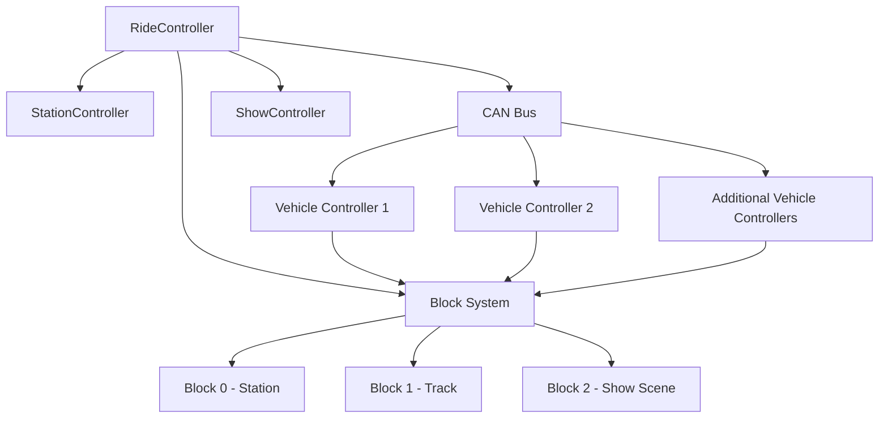

# Virtual Attraction Control System (VACS)


A C++17 simulation of a distributed attraction control system focused on multi-vehicle ride control, block-zone protection, station interlocks, CAN-style communication, fault handling, and synchronized show control.

VACS was built as a Computer Engineering portfolio project to demonstrate embedded/control-system architecture, safety-oriented logic, automated testing, and fault diagnostics in a themed-entertainment context.

> This project is an educational simulation. It does not reproduce any proprietary attraction-control architecture and is not intended for use as a certified safety-critical controller.

---

## Features

- Configurable multi-vehicle ride simulation
- Exclusive block-zone occupancy
- Station gate and restraint interlocks
- Operator dispatch requests
- Emergency-stop handling with explicit reset
- Simulated CAN communication
- Per-vehicle heartbeat and status messages
- Communication watchdogs
- Latched communication faults
- Fault-source diagnostics
- Show-scene triggering
- Lighting, animatronic, and audio show cues
- Event logging with simulation timestamps
- Catch2 automated tests
- CTest integration
- GitHub Actions continuous integration

---

## System Overview



`RideController` acts as the supervisory controller. It coordinates vehicle movement, station dispatch, block occupancy, communication monitoring, fault recovery, and show triggering.

---

## Multi-Vehicle Block Control

The vehicle fleet is configurable:

```cpp
RideController ride(4);
```

Vehicles move through three exclusive blocks:

```text
Block 0 - Station
      |
      v
Block 1 - Track
      |
      v
Block 2 - Show Scene
      |
      v
Ride Cycle Complete
```

A vehicle cannot enter a block that is already occupied.

Example operating state:

```text
Vehicle 2 | Block: 2 | State: MOVING
Vehicle 3 | Block: 1 | State: MOVING
Vehicle 4 | Block: 0 | State: MOVING
Vehicle 1 | Block: -1 | State: COMPLETED_CYCLE
```

This allows multiple vehicles to operate concurrently while maintaining block separation.

---

## Station Safety

Dispatch requires:

```text
Gate Closed
AND
Restraints Locked
AND
Emergency Stop Not Active
AND
Fresh Dispatch Request
```

Dispatch commands are consumed when an attempt is made. An unsafe request therefore cannot remain latched and later dispatch a vehicle automatically when conditions become safe.

---

## CAN-Style Communication

Each vehicle transmits simulated CAN messages during every control cycle.

| CAN ID | Purpose |
|---|---|
| `0x100 + Vehicle ID` | Vehicle heartbeat |
| `0x200 + Vehicle ID` | Vehicle status |
| `0x300` | Show trigger |

Examples:

```text
0x101 - Vehicle 1 Heartbeat
0x102 - Vehicle 2 Heartbeat
0x201 - Vehicle 1 Status
0x202 - Vehicle 2 Status
0x300 - Show Trigger
```

Vehicle status frames include block position, vehicle state, and packed status flags.

---

## Communication Watchdog

Each vehicle is expected to transmit a heartbeat.

After three consecutive missed heartbeats:

1. The affected vehicle enters `FAULTED`.
2. A communication fault becomes active.
3. Ride movement is inhibited.
4. Existing block occupancy is preserved.
5. The fault remains latched.

Restoring communication alone does not restart the ride.

Recovery requires restored heartbeat communication followed by an explicit fault reset.

Example diagnostic output:

```text
Communication Fault: ACTIVE | Source: Vehicle 2 | Missed Heartbeats: 3
```

---

## Emergency Stop

When E-stop is activated:

- Pending dispatch requests are cleared.
- Vehicles currently on the ride enter `EMERGENCY_STOP`.
- Block occupancy remains unchanged.
- Vehicle motion is inhibited.

Clearing the E-stop condition does not automatically restart motion.

An explicit reset is required.

---

## Show Control

Entering Block 2 triggers a show sequence.

```text
Tick 1 - LIGHTING
Tick 2 - ANIMATRONIC
Tick 3 - AUDIO / COMPLETE
```

A show-trigger CAN frame is also transmitted when a vehicle enters the scene.

The show controller can be triggered again when later vehicles reach the show block.

---

## Event Logging

Important control events are recorded with simulation tick numbers.

Example:

```text
[Tick 6] Vehicle 1 entered Show Block - show triggered
[Tick 10] Vehicle 2 entered Show Block - show triggered
[Tick 13] Communication fault detected for vehicle 2
[Tick 13] Communication fault reset failed: Vehicle 2 heartbeat missing
[Tick 14] Communication fault reset accepted
[Tick 15] Emergency stop activated
[Tick 16] Emergency stop cleared
[Tick 17] Emergency stop reset accepted
```

---

## Testing

VACS uses Catch2 for automated testing.

Coverage includes:

- Station interlocks
- Dispatch behavior
- Block occupancy
- Multi-vehicle separation
- Emergency-stop behavior
- CAN messages
- Heartbeat transmission
- Vehicle status frames
- Watchdog timeouts
- Fault latching
- Fault recovery
- Configurable fleet size
- Show control
- Event logging

GitHub Actions automatically builds and tests the project on pushes and pull requests to `main`.

---

## Build and Run

Requirements:

- C++17 compiler
- CMake
- Git

Configure and build:

```bash
cmake -S . -B build
cmake --build build
```

Run the demonstration:

```bash
./build/attraction
```

Run automated tests:

```bash
ctest --test-dir build --output-on-failure
```

Or from inside the build directory:

```bash
cd build
cmake --build .
./tests
./attraction
```

---

## Project Structure

```text
VirtualAttractionControl/
├── include/
│   ├── Block.h
│   ├── CanBus.h
│   ├── CanMessage.h
│   ├── CanProtocol.h
│   ├── RideController.h
│   ├── ShowController.h
│   ├── StationController.h
│   └── VehicleController.h
├── src/
│   ├── Block.cpp
│   ├── CanBus.cpp
│   ├── RideController.cpp
│   ├── ShowController.cpp
│   ├── StationController.cpp
│   └── VehicleController.cpp
├── tests/
├── docs/
│   ├── ARCHITECTURE.md
│   └── SAFETY.md
├── .github/workflows/
│   └── ci.yml
├── CMakeLists.txt
├── main.cpp
└── README.md
```

---

## Documentation

- [System Architecture](docs/ARCHITECTURE.md)
- [Safety and Fault Handling](docs/SAFETY.md)

---

## Technology

- C++17
- CMake
- Catch2
- CTest
- Git
- GitHub Actions

---

## Author

**Bennett Fix**

Computer Engineering student interested in embedded systems, control systems, automation, autonomous systems, and themed-entertainment technology.