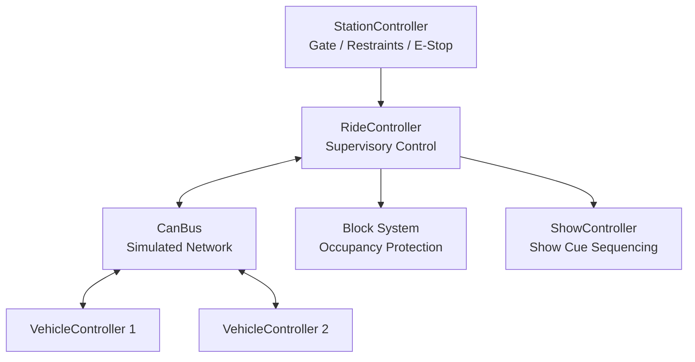

# Virtual Attraction Control System (VACS)


A C++ simulation of a distributed attraction control system featuring multi-vehicle block control, station safety interlocks, CAN-style communications, watchdog fault detection, explicit fault recovery, and synchronized show control.

VACS is designed as an engineering-focused simulation rather than a graphical ride simulator. The project emphasizes deterministic state machines, safety-oriented behavior, distributed communication, fault handling, and automated verification.

## Key Features

- Multi-vehicle block-zone control
- Protected block occupancy and vehicle ownership
- Configurable dwell timing
- Vehicle state-machine control
- Station gate and restraint interlocks
- Operator dispatch requests and permissives
- Emergency-stop handling with explicit reset
- Simulated CAN communication bus
- Vehicle heartbeat and status messages
- Bit-packed status flags
- Communication watchdog monitoring
- Heartbeat timeout detection
- Communication fault injection and recovery
- Ride-wide motion inhibition during communication faults
- Show-scene triggering based on vehicle position
- Lighting, animatronic, and audio show cues
- Catch2 unit and integration testing
- CMake / CTest build and test system
- GitHub Actions continuous integration

## Architecture



`RideController` coordinates attraction-level behavior while each subsystem maintains its own state and responsibilities.

## Safety-Oriented Design

VACS uses conservative control behavior throughout the simulation.

- Vehicles cannot enter an occupied block.
- A vehicle retains ownership of its current block during an E-stop or communication fault.
- Dispatch requires both valid safety permissives and a fresh operator request.
- Dispatch requests made while conditions are unsafe are rejected rather than stored.
- E-stop activation halts active vehicles and requires an explicit reset before motion resumes.
- Communication loss triggers a watchdog fault and inhibits ride motion.
- Restoring communication does not automatically clear a communication fault.

This separation between **permissives**, **commands**, **states**, and **faults** is intentional.

## CAN Communication

VACS includes a software simulation of CAN-style distributed communications.

Current message IDs include:

| CAN ID | Purpose |
|---|---|
| `0x101` | Vehicle 1 heartbeat |
| `0x102` | Vehicle 2 heartbeat |
| `0x201` | Vehicle 1 status |
| `0x202` | Vehicle 2 status |
| `0x300` | Show trigger |

Each vehicle publishes heartbeat and status information during control cycles.

Status messages include information such as:

- Vehicle ID
- Current block
- Vehicle state
- Bit-packed status flags

A watchdog monitors expected vehicle heartbeats. After three consecutive missed heartbeats, the system latches a communication fault and inhibits normal ride motion.

## Show Control

When a vehicle enters the designated show block, VACS generates a show trigger and starts a separate show-control state machine.

The current sequence includes:

```text
Tick 1 -> LIGHTING
Tick 2 -> ANIMATRONIC
Tick 3 -> AUDIO
          |
          v
       COMPLETE
```

Show control is kept separate from ride-safety logic so entertainment sequencing does not determine motion permissives.

## Automated Testing

VACS uses Catch2 for unit and integration testing.

The test suite covers:

- Station gate, restraint, and E-stop behavior
- Dispatch permissives and operator-request handling
- Block occupancy protection
- Multi-vehicle movement
- E-stop behavior and recovery
- CAN frame transmission
- Vehicle heartbeat and status messages
- Communication fault injection
- Watchdog timeout detection
- Communication fault recovery
- Show-controller state and cue sequencing
- Automatic show triggering from vehicle position

CTest is used as the project test runner, and GitHub Actions automatically builds and tests the repository on pushes and pull requests to `main`.

## Build

### Requirements

- C++17-compatible compiler
- CMake 3.16+
- Git

Catch2 is downloaded automatically through CMake `FetchContent`.

```bash
git clone https://github.com/bennettfix/VirtualAttractionControl.git
cd VirtualAttractionControl
mkdir -p build
cd build
cmake ..
cmake --build .
```

## Run

From the `build` directory:

```bash
./attraction
```

## Test

```bash
ctest --output-on-failure
```

The Catch2 executable can also be run directly:

```bash
./tests
```

## Technology

- C++17
- CMake
- CTest
- Catch2
- Git
- GitHub
- GitHub Actions
- WSL2 / Ubuntu
- Visual Studio Code

## Project Scope

VACS is an educational and portfolio simulation intended to demonstrate software and systems-engineering concepts relevant to embedded systems, controls, automation, and themed-entertainment technology.

It is not intended to reproduce any specific proprietary attraction-control architecture or serve as a certified ride-control system.

## Future Expansion

Potential future work includes:

- Physical CAN hardware
- STM32-based distributed controller nodes
- Motor and encoder simulation
- PID motion control
- Additional fault modes
- Operator HMI
- Event and fault logging
- More complex show sequencing
- Physical miniature attraction hardware

## Author

**Bennett Fix**

Computer Engineering student interested in embedded systems, controls, automation, and themed-entertainment technology.